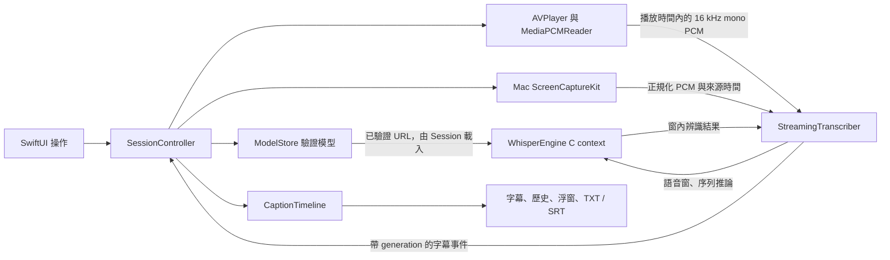

# 專案結構與維護指南

本文件依 2026-11-06 的實際程式整理，供後續定位功能、修改及驗證。產品入口是 [README](README.md)；功能驗收以 [Acceptance](Docs/Acceptance.md) 與有日期的 `Verification/` 證據為準。辨識參數以當前原始碼與測量紀錄為準；本文記錄責任與不變條件，不把編譯成功當成功能驗收。

## 1. 先從哪裡閱讀

| 位置 | 職責與關鍵入口 |
|---|---|
| [App/LiveCaptionApp.swift](App/LiveCaptionApp.swift) | SwiftUI App 入口；建立一個 `SessionController`，供所有 `WindowGroup` 視窗共用；Mac 全域選單與快捷鍵 |
| [App/Session](App/Session) | `SessionController` 協調模型、來源、播放、推論、歷史、錯誤與停止；`SessionPhase` 定義操作狀態；`SourceLanguageCatalog` 統一來源語言；`AppPreferences` 保存外觀，與語言／模型選擇共用注入的偏好儲存 |
| [App/Models](App/Models) | `WhisperModel` 固定模型目錄；`ModelStore` 狀態／選擇／使用鎖；`ModelDownload` 網路落盤；`ModelIntegrity` 大小與 SHA-256 驗證 |
| [App/Media](App/Media) | `MediaController` 持有 AVPlayer 與檔案存取權；`MediaPCMReader` 依播放時間讀 PCM；`PlaybackAudioSession` 管理 iPad 音訊工作階段；`NativePlayerView` 橋接公開 AVKit 控制項 |
| [App/Platform/macOS](App/Platform/macOS) | `MacSystemAudioCapture`／`AudioSink` 系統收音，`SystemAudioNormalizer` 轉換及來源時間；`CaptionPanelController`／`CaptionPanelPlacement` 無邊框浮窗與位置恢復，`CaptionPanelDragHandle`／`CaptionPanelResizeHandle` 提供原生拖移與縮放 |
| [App/UI](App/UI) | `RootView` 導航、選檔／匯出呈現；`CaptionWorkspaceView` 共用即時／媒體頁，並持有播放器拖曳狀態；`AdaptiveControls`／`CaptionPageContent` 統一排列／頁面框架；`FloatingCaptionView` 包裝共用字幕與滑鼠控制列，`FloatingCaptionOptions` 共用主視窗／浮窗的設定；`CaptionExport`／`CaptionDocument` 統一匯出資料；其他共用字幕視圖、模型／設定頁及視覺主題 |
| [App/Resources](App/Resources)／[Design/AppIcon](Design/AppIcon) | Mac／iPad 共用的圖示 catalog 與 `PrivacyInfo.xcprivacy`；圖示母圖、提示詞及機械尺寸匯出入口 |
| [Packages/CaptionCore](Packages/CaptionCore) | 可獨立測試的 Swift package：音訊處理、辨識排程、whisper.cpp C context、字幕調和／時間軸／匯出；不依賴 App UI |
| [Config](Config) | Mac sandbox entitlements、iPad Info.plist；其他生成的 Info.plist 欄位在 `project.yml` |
| [LiveCaption.xcodeproj](LiveCaption.xcodeproj)／[project.yml](project.yml) | 已交付的 Xcode 工程及 XcodeGen 定義；Mac、iPad、iPad hosted test targets |
| [Experimental](Experimental) | 獨立 ReplayKit／PiP 可行性工具與自己的 Xcode 工程；不嵌入主產品、不載入 Whisper |
| [Tests](Tests)／[CaptionCoreTests](Packages/CaptionCore/Tests/CaptionCoreTests) | App 整合 harness、平台／模型／媒體回歸、iPad hosted XCTest；核心單元測試在 package 內 |
| [Scripts](Scripts) | 開發者下載固定引擎、建置、測試及取得測試資料的入口；`test-support.sh` 共用 App harness 編譯，公開測試腳本保留參數介面；App 不會啟動這些腳本 |
| [ThirdParty](ThirdParty) | 引擎版本／雜湊 manifest、授權原文，以及實際打包進兩平台 App 的 notices |
| [Docs](Docs)／[Verification](Verification) | 技術決策、平台限制、驗收矩陣，以及實際執行產生的 JSON／SRT／log／測試摘要 |
| [PRODUCT.md](PRODUCT.md)、[DESIGN.md](DESIGN.md)、[UX-CONTRACT.md](UX-CONTRACT.md) | 產品範圍、視覺規則、操作與資料保留約定；更改產品行為時一併核對 |

核心檔案的分工：

| 檔案 | 關鍵型別／不可混在一起的責任 |
|---|---|
| [AudioProcessing.swift](Packages/CaptionCore/Sources/CaptionCore/AudioProcessing.swift) | `PCMNormalizer` 混音／重採樣；`SpeechWindowBuilder` 能量型 VAD、前滾、重疊語音窗與尾段 flush |
| [StreamingTranscriber.swift](Packages/CaptionCore/Sources/CaptionCore/StreamingTranscriber.swift) | 有界待辨識工作、最新臨時任務、worker、epoch、狀態及 metrics；不控制 AVPlayer |
| [WhisperEngine.swift](Packages/CaptionCore/Sources/CaptionCore/WhisperEngine.swift) | `SpeechRecognizing` actor 介面；`WhisperEngine` 對 C API 的薄層封裝、載入／取消／釋放、語言及解碼設定 |
| [CaptionReconciler.swift](Packages/CaptionCore/Sources/CaptionCore/CaptionReconciler.swift) | 單次串流內音訊重疊窗的文字去重、臨時文字與確認文字；不處理跨 seek 的歷史政策 |
| [CaptionTimeline.swift](Packages/CaptionCore/Sources/CaptionCore/CaptionTimeline.swift) | `CaptionTimeline` 維護跨 seek／重播的主字幕；衝突新結果保存為 `CaptionAlternative`，不改寫既有確認文字 |
| [Caption.swift](Packages/CaptionCore/Sources/CaptionCore/Caption.swift) | `RecognitionSegment`、`CaptionSegment`、事件／metrics、generation envelope、`CaptionExporter` |
| [CaptionProbe/main.swift](Packages/CaptionCore/Sources/CaptionProbe/main.swift) | 開發用真正推論 CLI：直接解碼、模擬即時輸入、取消及測量；不屬於 App 執行流程 |

## 2. 從音訊到字幕的資料流



1. UI 的開始／暫停／停止／跳轉／切模型操作交給 `SessionController`，不要直接從 View 呼叫 C API 或建立另一個辨識 worker。
2. `ModelStore` 只提供已驗證模型。Session 先標記使用中的 model ID，再請 `WhisperEngine` 載入，避免載入期間被切換或刪除。
3. 本機媒體由 AVPlayer 提供實際播放時鐘，`MediaPCMReader` 用 AVAssetReader 解碼並切出「已播放」部分；Mac 系統音訊由獨立 serial queue 轉換，再經有界 AsyncStream 進入 Session。
4. 共用入口是 16 kHz、單聲道、Float PCM 及來源起始秒數。`SpeechWindowBuilder` 建立語音窗，`StreamingTranscriber` 排程，`WhisperEngine` 回傳窗內時間，`CaptionReconciler` 加回來源 offset 並去除確實重疊的文字。
5. Session 消費 `taggedEvents`，先檢查 generation，再更新臨時字幕／歷史。確認結果送入 `CaptionTimeline`；UI 與匯出讀取同一份主字幕，不自行再整理另一條時間軸。

目前沒有翻譯、遠端辨識或網路音訊傳輸。手動語言及可選自動偵測進入同一原文轉寫流程；`translate` 必須保持 `false`。直接檔案解碼的耗時與即時播放到字幕顯示的延遲是不同指標。

Mac 系統音訊新增前台啟用範圍：`CaptionScopePreferences` 保存始終／指定 App 或網站與清單，`ForegroundContextMonitor` 透過 NSWorkspace 與經授權的唯讀 Apple Events 提供當前內容，`SessionController` 統一控制自動暫停／恢復。只由使用者按開始後啟用；手動暫停／停止撤銷自動恢復。範圍離開立即關閉 PCM／結果入口，取消未確認尾音，停止 capture 並保留模型及已確認歷史；快速離開再返回也要完成舊 generation 的失效。網址不可讀時不允許網站規則，不能沿用過期網址。詳見 [CaptionScope](Docs/CaptionScope.md)。

## 3. Actor、執行緒與資源所有權

| 擁有者 | 隔離方式 | 維護要求 |
|---|---|---|
| `LiveCaptionApp` → `SessionController` | `@MainActor @Observable` | 多視窗共享一個工作階段；Session 擁有 engine、transcriber、models、media、preferences、Mac capture／panel 及 task handles |
| `ModelStore` | UI 狀態在 MainActor；雜湊在 detached utility task | 每次下載／校驗以 operation ID 決定誰能更新狀態；取消後的舊回呼不可覆蓋重試結果 |
| `ModelDownload` | serial URLSession delegate queue＋鎖 | 直接落盤；續接 continuation 只完成一次；取消、進度與完成可能交錯 |
| `MediaController`／`MediaPCMReader` | 播放器與可見狀態在 MainActor；reader 是 actor | reader 擁有 asset、track、AVAssetReader 及未播放的 pending PCM；資源關閉完成後才釋放 security-scoped URL |
| `PlaybackAudioSession` | actor | 序列化 iPad `AVAudioSession` 啟停，避免耗時路由操作佔用 UI executor |
| Mac capture／`AudioSink` | capture 生命週期在 MainActor；音訊在獨立 serial queue | `PCMNormalizer` 不是共享的 Sendable 服務；同一實例只在其擁有 queue 上使用。每次 capture 有新的 sink 與 ingress |
| `StreamingTranscriber` | actor | 一個排程 worker；確認窗佇列有上限，臨時窗合併為最新工作；淘汰需回報略過音訊秒數 |
| `WhisperEngine` | actor＋可跨 actor 呼叫的鎖保護取消旗標 | 一個 actor 擁有一個 C context，load／decode／free 序列化；UI 不持有或釋放指標 |
| `CaptionTimeline` | value type，由 Session 的 MainActor 擁有 | 只有通過 generation 檢查的結果能修改它；容量不足須上報並停止，不能默默丟棄舊歷史 |
| Experimental handler／PiP | handler 以鎖管理狀態；PiP UI／timebase 在 MainActor | 框架終止呼叫放在鎖外；同步播放狀態查詢用鎖，delegate 不直接從不明執行緒改 UIKit |

Actor 是隔離邊界，不表示每個 actor 都有一條專用實體執行緒。耗時 C 推論不得搬到 MainActor；音訊 callback 也不得為每個 buffer 建立無上限 Task。

### 取消分成三層，不能只取消 View 的 Task

- **App 操作 generation（UUID）**：Session 的載入、seek、來源 feed、watchdog 在每個關鍵 `await` 後檢查 token。`stopTask` 合併同時到達的停止要求，清理完成前維持 stopping 狀態。
- **字幕 epoch／`currentGeneration`**：`StreamingTranscriber.reset`／`stop` 立即失效舊工作，清除排隊窗並取消推論。即使舊事件已進入 AsyncStream 緩衝，Session 仍用 `GenerationTaggedEvent` 拒收；不要把 UI 改回未標記的 `events`。
- **引擎 operation flag**：每次 load／decode 擁有自己的取消旗標，舊 Task 遲到的取消不能打斷新 decode。`cancel()` 可繞過 actor 通知 C abort callback；釋放仍回到 engine actor。C 模型載入不等同可立即中斷的 Swift `await`，取消後可能要等 C 函式返回再清理。

媒體另有 reader `openRevision` 與 controller `itemRevision`，防止舊 open／seek 復活已關閉媒體。Mac capture 也有自己的 generation，舊 AsyncStream 終止不能停止後來的新 capture。這些 ID 分屬不同資源，不能互相取代。

## 4. 媒體時間軸與操作不變條件

來源語言以 [SourceLanguageCatalog](App/Session/SourceLanguage.swift) 的引擎代碼為唯一來源，Picker 不另存顯示名稱。Session 把選擇存於 UserDefaults 的 `sourceLanguageCode`，重啟時驗證並恢復；無效值回退到首次預設值。`auto` 映射為 nil，仍執行原文轉寫。英文用 `en`，普通話用 `zh`，不可選英文專用模型來代替共用多語言模型，也不可因選中文而擅自啟用翻譯或繁簡轉換。修改後跑 `bash Scripts/test-language-settings.sh`，再跑對應語音與 iPad 整合回歸。

| 操作／資料 | 必須保持的行為 |
|---|---|
| 媒體 PCM／字幕 | 使用 asset 的播放秒數；不以下載時間、wall clock 或 UI 計時器次數代替。只辨識已播放部分，pending 未播放 PCM 留在 reader |
| 系統音訊 | `SystemAudioNormalizer` 以來源 PTS 正規化、保留前向缺口並避免回退；Session 加上本次字幕工作階段的單調時鐘 offset。不要把它當成本機影片可重播的 asset 時間 |
| App 暫停 | 先凍結播放器，等正在讀取的 feed 完成，再補送截至暫停位置的尾音，最後 flush／等待確認。直接取消 reader 工作可能吞掉已消耗但尚未 append 的音訊 |
| 原生播放器暫停 | 同樣補齊已播放尾音；恢復時重啟語音窗。App 播放鍵需反映 AVPlayer 目前狀態，不能只看 Session phase |
| 正常 EOF | 補齊最後已播放音訊，完成最後辨識，保留歷史與模型；不能把 EOF 的 `timeJumped` 通知誤當 seek 而刪掉尾句 |
| 暫停／EOF 後繼續 | Session 的 `LoadedConfiguration(modelURL, requestedGPU)` 只記錄成功載入配置；配置相同且 `engine.loadedModelURL` 仍匹配才重用 C context。不能每次 resume 都重新讀入模型，也不能只看 UI selected ID 就假定 context 可用 |
| seek／直接跳至 EOF | 先失效舊推論與 partial，重設 reader 至新播放位置；不辨識被跳過的區間。真正的 seek 與 UI 輪詢延遲／正常倍速前進要區分 |
| stop | 取消來源、停止 capture、失效字幕事件、卸載模型，然後清除成功載入配置快取、解除 model 使用鎖及音訊工作階段；清除 partial，保留確認歷史供匯出 |
| 切來源／匯入新媒體 | 先完成 stop；新來源就緒後明確清除舊歷史。失敗匯入不能保留假播放狀態或舊 reader PCM |
| 清除歷史 | 同時 reset transcriber，避免在途或已排隊的舊事件把文字加回來 |
| iPad 進背景／記憶體警告 | 停止並釋放模型；音訊中斷開始時暫停，交由使用者恢復。單一視窗 scenePhase 不代表整個多視窗 App 已進背景 |

`RecognitionSegment` 的時間相對於推論窗；`CaptionSegment` 的時間已在來源時間軸上。短片補靜音等引擎處理不能改變原始 offset，也不能把字幕延伸到實際音訊之外。

模型 URL 或 GPU 要求改變必須重新載入；CPU 備援的實際 backend 與使用者的 `requestedGPU` 是不同狀態。任何未經 Session 的卸載都必須同步使載入快取失效。修改此路徑時要另外驗證冷啟動、重複 pause／resume、EOF 後繼續、改配置及 stop 後重新開始，不能只看字幕有出現就認為模型有正確重用／釋放。

`CaptionReconciler` 只對實際重疊語音窗去重。稍後重新說出的同一句話應保留。`CaptionTimeline` 對重播保留首次確認的主字幕；能證明的邊界重複才裁去，不能按時間比例切字。無法安全合併的新結果放入 alternatives，可另匯出 TXT；主 SRT 維持排序、不重疊，只輸出確認字幕。歷史目前在記憶體中，關閉 App 前需匯出，沒有自動持久化字幕資料庫。

## 5. 模型、沙盒、版本與授權

模型設定的執行來源是 [WhisperModel.swift](App/Models/WhisperModel.swift)。來源 revision、位元組數及 SHA-256 的查核證據在 [Models.md](Docs/Models.md) 與 [model-manifest.json](Docs/model-manifest.json)。模型選擇和外觀偏好存在 UserDefaults；模型權重放在系統提供的 Application Support 下 `LiveCaption/Models`，不硬編使用者家目錄、不進原始碼、不隨 App 預設全部打包。

下載流程為：可用空間檢查 → URLSession 暫存落盤 → `Downloads/<operation UUID>.partial` → 一般檔案／非符號連結、精確大小、串流 SHA-256 校驗 → 搬至正式檔名 → `.installed`。既有檔案啟動時也須校驗；保存過的 selected ID 不代表檔案已可用。取消／重試使用新 operation ID；啟動掃描須先保留 `.verifying` 狀態，避免與下載或刪除競爭。

精確下載大小、記憶體規劃估值、裝置實體 RAM、iPad 可用程序記憶體是不同概念。下載完成或通過檔案驗證不保證大型模型能載入／即時運行。Session 在載入前鎖定 active model，卸載完成後才解除；UI 更改選擇不得略過此流程。

媒體選檔透過系統 file importer 取得 security scope，由 `MediaController` 保存到 reader 關閉為止；主產品不把使用者音訊上傳。匯出使用原生 file exporter，Mac 的 user-selected read-write entitlement 供選檔／存檔使用。

引擎版本與 binary checksum 以 [whisper-dependency.json](ThirdParty/whisper-dependency.json) 為準，[fetch-whisper.sh](Scripts/fetch-whisper.sh) 必須與之同步。更新引擎或模型來源時，同步檢查 package、下載腳本、模型目錄／manifest、測試固定雜湊及 API 相容性；不只換 URL。保留 [引擎 MIT](ThirdParty/whisper.cpp-LICENSE)、[ggml MIT](ThirdParty/ggml-LICENSE)、[模型 MIT](ThirdParty/Models/Whisper-LICENSE.txt) 與實際打包的 [ThirdPartyNotices.txt](ThirdParty/Notices/ThirdPartyNotices.txt)。參考專案採用界線見 [ReferenceAudit](Docs/ReferenceAudit.md)。

加速與解碼政策集中在 `WhisperEngine`；目前 Simulator 明確使用 CPU，真機依可用 Metal 條件選用。Core ML encoder 資產未交付，不應標示 Core ML 已啟用。**調參前讀當前 engine／window builder／scheduler 定義，調參後以相同音訊重測；此結構文件不複製 VAD 門檻、窗長、解碼策略或 token 限制等容易漂移的數值。** 最新排程設計及逐樣本邊界回歸見 [核心延遲設計](Verification/engine/latency/README.md)，真人錄音的速度／品質／成本對比見 [延遲基準](Verification/latency/README.md)。推論忙時只暫緩建立臨時窗，PCM 仍持續累積；不能為追求較新的 partial 反覆取消在途工作，也不能停送音訊或改變 final 的邊界。

## 6. 平台與 Experimental 的邊界

| 位置／平台 | 產品責任 | 不可擴大解讀的範圍 |
|---|---|---|
| macOS 26＋ | ScreenCaptureKit 系統收音、NSPanel 浮窗；也支援 App 內本機媒體 | 離線 PCM／幾何測試不證明錄製權限、全螢幕影片、多顯示器縮放或點擊穿透已實測 |
| iOS／iPadOS 26＋主產品 | iPhone／iPad 通用 App；本機媒體前景播放＋本機辨識；公開 AVKit 播放控制；窄版底部分頁／寬版側欄 | 不依賴 ReplayKit extension；沒有保活用的虛假背景模式；不宣稱跨 App 背景推論 |
| [ReplayKitProbe.xcodeproj](Experimental/ReplayKitProbe.xcodeproj) | 診斷 host、Broadcast Upload Extension、有界 App Group PCM ring、公開 API PiP 狀態畫面 | 畫面是診斷資料，不是辨識字幕；不載入模型、不連伺服器；不能視為產品已完成 |
| iPadOS 27＋研究路徑 | 官方 ScreenCaptureKit／系統 picker／正式 screen-capture 背景能力已查核 | 本專案尚未實作該路徑；背景擷取能力不自動等於 Whisper GPU／PiP 長時間可用 |

完整 API、簽署與待真機測量項目見 [PlatformFeasibility](Docs/PlatformFeasibility.md)。受保護本機 asset 可由 AVFoundation 拒絕；系統收音靜音可能有多種原因，不能只憑全零音訊判定 DRM。

## 7. 修改哪層，至少驗證什麼

以下是修改後的選測入口，不表示每次文件更改都要重跑全部。新增失敗、共用介面改動或新風險才擴大測試；保留真實失敗輸出，不靠假字幕通過。

| 修改範圍 | 對應檢查 | 仍不能替代 |
|---|---|---|
| VAD／分段／去重／排程／generation／匯出 | `swift test --package-path Packages/CaptionCore`；用 `CaptionProbe` 對固定日語／法語錄音跑真正推論，必要時測 `--stream`／取消 | 影視／音樂品質、兩小時與真機效能 |
| 模型下載／校驗／狀態／目錄 | `bash Scripts/test-models.sh`；修改網路流程時再用 `--network` 做真實 tiny 下載／取消重試 | 磁碟耗盡、大型模型及實際 UI 網路狀態 |
| 媒體解碼／security scope／seek | `bash Scripts/test-media.sh /path/to/audio-or-video`；相關 Session 整合回歸 | 外部檔案提供者授權及各種 DRM 格式 |
| Session 操作／暫停／EOF／模型切換 | `bash Scripts/test-session.sh /path/to/ggml-tiny.bin /path/to/ja_jp-0.wav`；另測法語 MP4 | 按鈕／檔案選取器／多視窗可視互動 |
| Mac 前台 App／網站啟用範圍 | `bash Scripts/test-caption-scope.sh`；`bash Scripts/test-caption-scope-session.sh /path/to/ggml-tiny.bin` | 真實瀏覽器授權、分頁與系統收音整條流程 |
| Mac 音訊 adapter／有界入口／浮窗幾何／probe ring | `bash Scripts/test-platform-audio.sh` | 不會建立 SCStream／NSPanel，不代表實際系統收音及浮窗互動 |
| iOS 工作階段／音訊中斷／預設加速／窄版導航 | [test-ios-simulator.sh](Scripts/test-ios-simulator.sh) 執行 6 項真實推論與 4 項原生版面 hosted XCTest，核對 10 通過且無跳過；舊 iPad 入口保留 | Simulator CPU 不等於 iPhone／iPad Metal、熱與記憶體表現 |
| SwiftUI／AVKit wrapper／外觀 | `bash Scripts/build.sh all`；依 [UX-CONTRACT](UX-CONTRACT.md) 做 Mac／iPhone／iPad 方向、大小、無障礙與操作檢查 | 編譯不能代替實際畫面驗收 |
| ReplayKit／PiP | 平台離線回歸＋獨立 probe Simulator／device build；再按平台矩陣做真機 | 主產品可用的跨 App 全本機字幕 |
| 引擎 binary／project／signing／最低 OS | 三種 [build.sh](Scripts/build.sh) 目標、核心測試、Session／iPad 整合；核對 notices 與 plist | unsigned build 不證明安裝、Team entitlement 或商店發布 |

常用較完整命令：

```sh
# 日語 Session；可省略第三參數，腳本自行建立核心產物
bash Scripts/test-session.sh \
  "/path/to/ggml-tiny.bin" "/path/to/ja_jp-0.wav"

# 法語影片，第三參數空字串表示自行建立核心產物
bash Scripts/test-session.sh \
  "/path/to/ggml-tiny.bin" "/path/to/fr-native-video.mp4" "" fr

# 純核心即時輸入驗證；這是開發 CLI，不是 App 執行依賴
swift run --package-path Packages/CaptionCore CaptionProbe \
  --model "/path/to/ggml-tiny.bin" --audio "/path/to/ja_jp-0.wav" \
  --language ja --stream --srt /tmp/live-caption-check.srt

# 使用本機實際存在的 iPhone 或 iPad Simulator UDID；會安裝並啟動測試 host
bash Scripts/test-ios-simulator.sh \
  "SIMULATOR_UDID" "/path/to/ggml-tiny.bin" "/path/to/fixture-directory"
```

`test-platform-audio.sh` 與 `test-session.sh` 目前針對 Apple Silicon／arm64。測試模型與錄音放在 `/tmp` 或明確提供的資料目錄，不加入原始碼。真人音訊來源、固定雜湊及 CC BY 4.0 聲明見 [Fixtures](Tests/Fixtures/README.md)。可選 [fetch-test-audio.py](Scripts/fetch-test-audio.py) 只取得開發資料；[make-video-fixture.sh](Scripts/make-video-fixture.sh) 用真人音訊建立測試 MP4，不生成假字幕。

## 8. 工程生成、建置與簽署

一般開發直接開啟已提供的 Xcode 工程。首次 checkout 缺少 binary 時，先跑 `bash Scripts/fetch-whisper.sh`；只有修改工程定義、增刪 source 或 target 時，使用 **XcodeGen 2.46.0** 重新生成並一併保留 YAML、pbxproj、shared schemes：

```sh
xcodegen generate --spec project.yml
xcodegen generate --spec Experimental/project.yml --project Experimental
bash Scripts/build.sh mac
bash Scripts/build.sh ios-simulator
bash Scripts/build.sh ios-device
```

主產品兩個 target 的產物名稱均為 `LiveCaption.app`。修改產品名稱時，必須同時核對 target-level `productName`、build settings、scheme `BuildableName`、測試 `TEST_HOST`／`BUNDLE_LOADER` 與腳本安裝路徑；避免只改 `PRODUCT_NAME` 後產生互相矛盾的工程資訊。`all` 只建置 Mac＋iPad Simulator，device 需另跑。

`AppIcon` 由兩個 App 共用 `App/Resources/Assets.xcassets`；修改圖示母圖後執行 `bash Scripts/generate-app-icons.sh`，再確認三個建置目標。版本與建置編號由 `project.yml` 寫入 bundle；關於頁與模型下載的 User-Agent 讀取 bundle，避免另外硬編版本。[隱私清單](Docs/Privacy.md) 隨兩平台打包；更改偏好、計時、儲存空間 API 或引擎時須重新核對用途與官方理由。

使用完整 Xcode Developer 目錄；目前驗證工具鏈及最低 OS 見 [README](README.md)。`build.sh` 預設只做 unsigned 編譯／連結。真機執行請在 Xcode 設自己的 Team、唯一 bundle ID、裝置 Developer Mode；Mac 錄製權限須由 OS 實際授予。主產品不需 App Group，probe 的 host／extension 才需相同 Team 與有相同群組的 provisioning profiles。詳細設定依 [README 簽署指引](README.md) 與 [probe 指引](Docs/PlatformFeasibility.md)。

## 9. 驗證證據與未完成項如何維護

索引以 [Acceptance](Docs/Acceptance.md) 為主；[BugAudit](Docs/BugAudit.md) 記錄已修缺陷；[核心證據](Verification/engine/README.md)、[Base 比較](Verification/base/README.md)、[Session 整合](Verification/session-integration.md)、[最新 bug 回歸 iPad 結果](Verification/bug-audit/ipad/README.md)、[平台自查](Verification/platform-bug-review.md) 各有獨立測量範圍。

更新證據時：

1. 記錄日期、來源版本／雜湊、Xcode／OS、實體裝置或 Simulator、模型 ID／SHA、音訊來源與雜湊、實際 backend、執行命令及退出狀態。
2. 保存原始 JSON／SRT／log、XCTest 摘要與附件；明確列出通過、失敗、跳過。不要只保留摘要或刪除較差辨識結果。
3. 改參數後用相同素材與評分規則比較，區分完整短片解碼、即時首字／確認延遲、RSS 與檔案大小；CER／WER 也不能直接互相比高低。
4. 不覆寫舊測試而讓它看起來對應新版本；以新子目錄或日期保存並標示歷史結果。臨時 `.xcresult` 的重要摘要／附件要另存到 `Verification/`，因 `/tmp` 不持久。
5. 最後更新 Acceptance 對應列及 README 入口；只有實際測過的範圍才標記通過。同步修正本文中受到影響的檔案位置、責任與不變條件。

尚需實體 iPad、Mac 系統音訊與權限撤銷、全螢幕／多螢幕／不同縮放、PiP／背景推論、受保護來源、兩小時長片、熱降頻／記憶體壓力、大型模型、背景音樂與多人說話測試。最新狀態以 Acceptance 為準；目前的短音訊、Simulator 和離線測試不得擴大成這些項目已通過。
